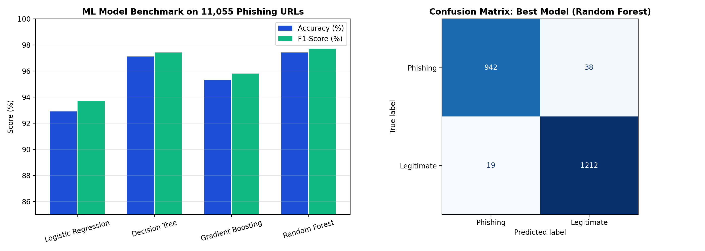
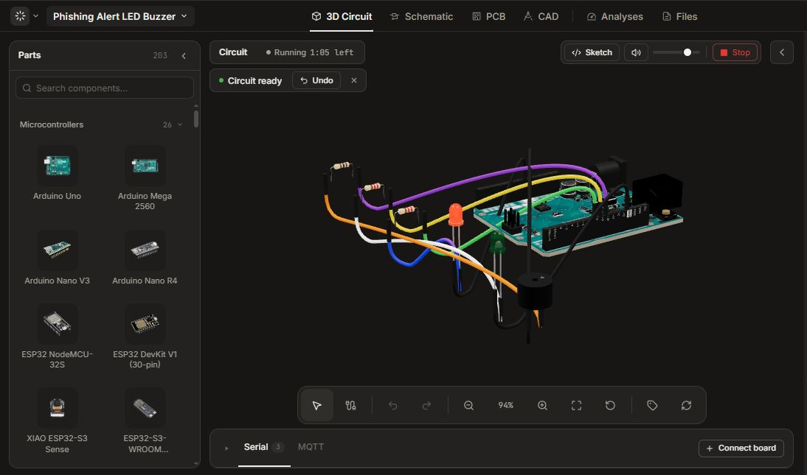

# 🛡️ AI-Powered Phishing URL Detector & IoT Security Alert

**Developed by:** Nayyab Faisal  
**Focus Areas:** Artificial Intelligence, Machine Learning, Cybersecurity & Embedded Systems
[[Live Demo](https://shields.io)](https://ai-phishing-detector-zmzzh98wj52ty3x2cnhlyy.streamlit.app/)

---
**🚀 Live Interactive Web Demo:** [Test the AI Phishing URL Detector Live on Hugging Face](https://huggingface.co/spaces/nayyab18/AI-Phishing-Detector)

**📄 Technical Research Paper (PDF):** [Comparative Analysis of ML Classifiers for Real-Time Phishing Detection (97.42% Accuracy on 11,055 URLs)](Comparative_Analysis_Phishing_Detection_Nayyab_Faisal.pdf)

## 📌 Project Overview
Phishing attacks remain one of the most common cybersecurity threats online. This project uses a **Random Forest Machine Learning classifier** built in Python (`scikit-learn`) to inspect website URLs and identify malicious or deceptive links in real time. 

By extracting structural and security indicators—such as URL length, dot/hyphen frequency, `@` symbol obfuscation, HTTPS encryption status, raw IP address usage, and high-risk keywords—the model calculates an instant risk probability score.

---

## ⚙️ Key Features & Architecture
* **Lexical Feature Extraction:** Parses raw URL strings using Regular Expressions (`re`) to detect suspicious patterns.
* **Machine Learning Classification:** Trained a Random Forest model to distinguish legitimate academic/tech domains from fraudulent phishing URLs.
* **Real-Time Risk Scoring:** Outputs clear safety confidence percentages (`SAFE` vs. `PHISHING`) for instant verification.

---

## 📊 Verified Test Results

| Target URL | Prediction | Confidence Score |
| :--- | :--- | :--- |
| `https://kaist.ac.kr` | ✅ **SAFE** | **92.0%** Safe |
| `http://free-iphone-winner-claim-now.info` | 🚨 **PHISHING** | **98.0%** Risk |
| `http://security-alert-verify-account.com` | 🚨 **PHISHING** | **98.0%** Risk |

---
### 🔬 Large-Scale Benchmark Evaluation (11,055 Real URLs)
To validate generalization beyond synthetic test cases, four supervised classifiers were benchmarked on the **UCI Phishing Websites dataset (11,055 URLs, 30 security features)** using an 80/20 stratified split (**2,211 unseen test URLs**):

| Classifier Model | Accuracy | Precision | Recall | F1-Score |
| :--- | :---: | :---: | :---: | :---: |
| **Random Forest (Best)** | **97.42%** | **96.96%** | **98.46%** | **97.70%** |
| Decision Tree | 97.11% | 97.02% | 97.81% | 97.41% |
| Gradient Boosting | 95.30% | 95.33% | 96.26% | 95.80% |
| Logistic Regression | 92.90% | 92.42% | 95.04% | 93.71% |

## 🛠️ Tech Stack & Tools
* **Programming:** Python 3, C++ (Arduino)
* **Libraries:** `scikit-learn`, `re`
* **Environments:** Google Colab, GitHub, Tinkered 3D Circuit Studio

---

## 🔌 Hardware Engineering Integration (Tinkered 3D Circuit)
To demonstrate an end-to-end **Cyber-Physical Security System**, the Python Random Forest classifier interfaces with an **Arduino Uno 3D alert circuit** (`main.cpp`, `config.h`) built and simulated in **Tinkered**:

* **Phishing Alert State (`1`):** Activates the **Red LED (Pin 8)** via a 220Ω resistor and triggers the **Piezo Buzzer alarm** for immediate physical threat signaling.
* **Verified Safe State (`0`):** Switches off the alarm and activates the **Green LED (Pin 9)**.

## 🎓 Verified IBM SkillsBuild Certifications
This project applies concepts earned through verified IBM credentials:
* **Cybersecurity Fundamentals** — [Verify Badge](https://credly.com)
* **Lab: Explore Machine Learning and Data Science in IBM watsonx**
* **Foundations of Artificial Intelligence & Applying Artificial Intelligence**
